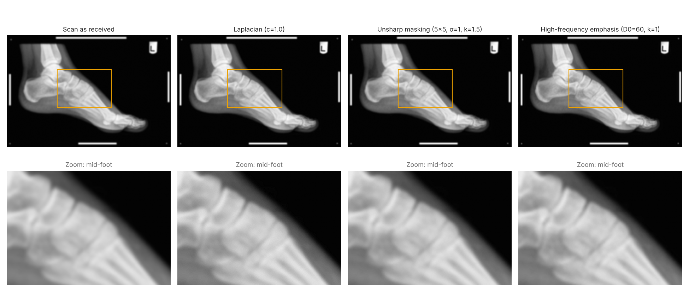
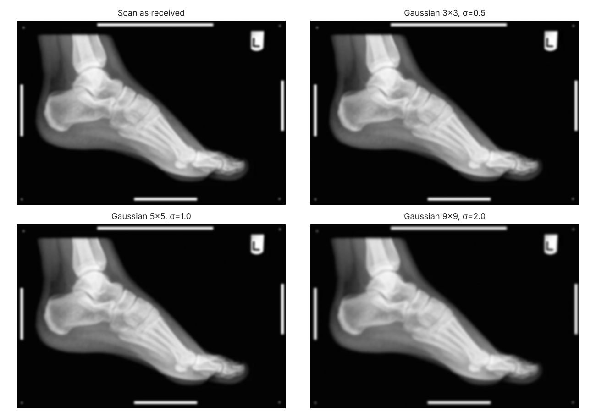
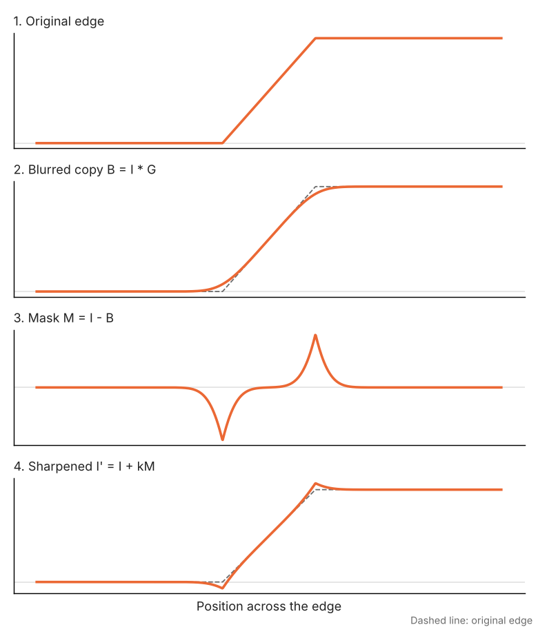
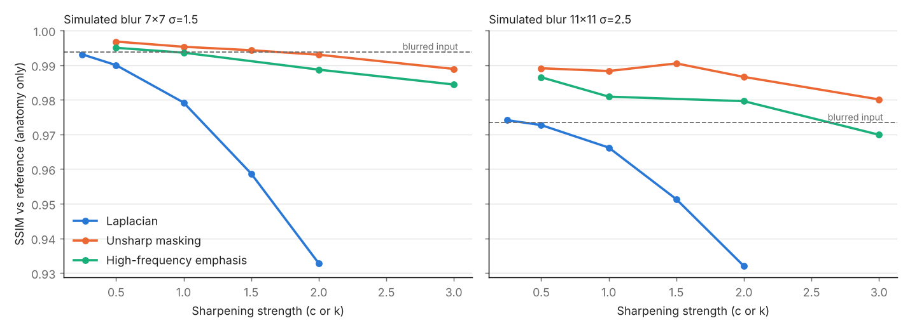
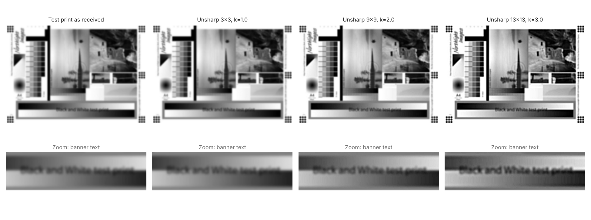
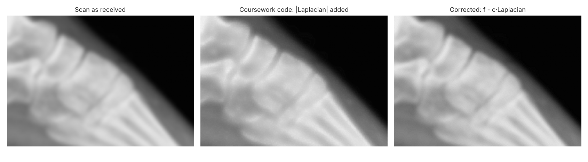

# X-ray Filter Toolkit

**Sharpening a blurred X-ray with Laplacian, unsharp masking and high-pass filtering, written in Python.**

Built with Python, NumPy, OpenCV, scikit-image and matplotlib. Includes a reusable filter module, a scoring script, a figure script and unit tests.

A blurred foot X-ray from a poorly maintained scanner is sharpened with three
classic methods, and the methods are compared with numbers as well as by eye.

**Result in one line:** unsharp masking gave the best restoration in every
controlled test, high-frequency emphasis came second, and the Laplacian filter
mostly added fine-scale noise. Pushing any method too hard creates halos and
clipping, which matters because an artefact on a medical image can be read as a
real feature.



## Contents

| Folder | What is in it |
|---|---|
| `sharpening/` | The filters (`filters.py`) and quality measures (`metrics.py`) |
| `scripts/` | `evaluate.py` runs the comparison; `make_figures.py` draws every figure |
| `results/` | Scores from the last run (`summary.md`, two CSV files) |
| `figures/` | All figures in this README, regenerated by the script |
| `tests/` | 9 unit tests that check each filter behaves as the theory says |
| `data/` | The two input images and where they came from |
| `legacy/` | The original coursework scripts, unchanged, for comparison |

## 1. The problem

The scan is blurred: bone edges and the boundary between bone and soft tissue
are soft, which makes fine detail hard to read. Blur removes high-frequency
content (edges and fine texture), so sharpening means putting that content
back. All three methods do this in different ways.

## 2. Methods

### Gaussian blur (how the problem is modelled)

Blur is modelled as convolution with a Gaussian kernel:

$$G(x,y) = \frac{1}{2\pi\sigma^2}\exp\left(-\frac{x^2+y^2}{2\sigma^2}\right), \qquad B = I * G$$

A larger kernel and σ remove more detail (Figure 1). The same model is used in
the controlled test below to blur the image by a known amount.



### Laplacian filtering (spatial domain)

The Laplacian is a second derivative, so it responds to rapid changes in
intensity:

$$\nabla^2 f = f(x{+}1,y) + f(x{-}1,y) + f(x,y{+}1) + f(x,y{-}1) - 4f(x,y)$$

$$g(x,y) = f(x,y) - c\,\nabla^2 f(x,y)$$

The minus sign is because this kernel has a negative centre.

### Unsharp masking and high-boost filtering

Subtract a blurred copy to isolate the edges (the mask), then add a scaled mask
back:

$$M = I - B, \qquad I' = I + k\,M = (1+k)\,I - k\,B$$

k = 1 is unsharp masking and k > 1 is high-boost filtering. Figure 3 shows the
steps on a single edge. The mask is negative just before the edge and positive
just after it, so adding it steepens the edge. The small dip and peak it leaves
are the start of the halos seen when k is too large.



### High-pass filtering (frequency domain)

A Butterworth high-pass filter keeps high frequencies and blocks low ones:

$$H_{HP}(u,v) = \frac{1}{1 + \left[D_0 / D(u,v)\right]^{2n}}$$

where D is the distance from the centre of the spectrum, D₀ the cut-off and n
the order. On its own a high-pass filter removes the overall brightness, so it
is used as **high-frequency emphasis**, which adds the filtered detail back:

$$G(u,v) = \left[1 + k\,H_{HP}(u,v)\right] F(u,v)$$

### Parameters

| Method | Parameter | Effect |
|---|---|---|
| Laplacian | c | Strength of the added edge detail |
| Unsharp masking | kernel size, σ | How wide the blur is, so how coarse the detail being boosted is |
| Unsharp masking | k | Strength of sharpening |
| High-frequency emphasis | D₀ | Cut-off: lower values boost coarser detail too |
| High-frequency emphasis | n, k | Steepness of the cut-off, strength of sharpening |

## 3. Comparing the methods with numbers

The original coursework compared the methods by eye. Two tests were added to
back that judgement with measurements.

### Test A: controlled blur (has a reference)

There is no sharp version of the real scan to compare against. So the scan is
treated as the reference, blurred again by a known amount, and each method
tries to undo that extra blur. Each method was run over a grid of settings (36
in total). Scores are measured **inside the anatomy only**, because the large
black background would make every score look better than it is. Two blur
levels were used, so that no method wins only because its settings happen to
match one blur.

**Best setting for each method (chosen by SSIM; 1.0 = identical to the reference)**

| Simulated blur | Blurred input | Laplacian | Unsharp masking | High-freq. emphasis |
|---|---|---|---|---|
| 7×7, σ = 1.5 | 0.9938 | 0.9931 (c = 0.25) | **0.9968** (9×9, σ = 2, k = 0.5) | 0.9950 (D₀ = 60, k = 0.5) |
| 11×11, σ = 2.5 | 0.9734 | 0.9741 (c = 0.25) | **0.9905** (9×9, σ = 2, k = 1.5) | 0.9865 (D₀ = 30, k = 0.5) |

The PSNR results tell the same story: unsharp masking reached 48.8 dB and 42.1
dB at these settings, against 40.4 dB and 32.7 dB for the blurred inputs. All
scores are in [`results/summary.md`](results/summary.md) and
[`results/controlled_test.csv`](results/controlled_test.csv).



What this shows:

- **Unsharp masking is best at both blur levels**, and it stays above the
  blurred input across most settings, so it is not fragile.
- **The best unsharp settings use a 9×9 blur with σ = 2**, close to the blur
  being undone. Unsharp masking works best when its own blur roughly matches
  the blur in the image.
- **The Laplacian never clearly improves on the blurred input.** Its 3×3
  kernel only reacts to detail one or two pixels wide, but the blur here
  spreads edges over many pixels. So it mainly boosts pixel-scale noise.
  Stronger settings make the score worse.
- **High-frequency emphasis** is a good second, but too low a cut-off with a
  high k degrades the image quickly.

### Test B: the real scan (no reference)

Each method was applied to the actual blurred scan at one moderate setting.

| Method | Setting | Edge strength ↑ | Background noise ↓ | Clipped pixels |
|---|---|---|---|---|
| None | – | 42.35 | 0.009 | 0.02% |
| Laplacian | c = 1.0 | 45.81 | 0.048 | 0.14% |
| Unsharp masking | 5×5, σ = 1, k = 1.5 | 44.46 | 0.020 | 0.07% |
| High-freq. emphasis | D₀ = 60, k = 1 | 45.42 | 0.019 | 0.08% |

Edge strength is the mean gradient inside the anatomy. Background noise is the
fine detail left in the flat black background, where there should be none.
All three methods make edges stronger. The Laplacian gets there by amplifying
background noise about five times; the other two roughly double it. Without a
reference these numbers cannot rank the methods on their own, so Test A is the
main evidence.

## 4. Too much sharpening

The same unsharp filter was applied to a blurred black-and-white test print at
increasing strength (Figure 5). Moderate settings make the banner text and the
grey steps clearer. At 13×13 with k = 3 the image is over-sharpened:

- **halos:** a bright rim along the bright side of each edge and a dark rim
  along the dark side;
- **clipping:** smooth gradients turn into flat black or white bands, so real
  detail is lost;
- **an unnatural look:** texture and contrast no longer match the original
  scene.

On a medical image, a halo along a bone edge could be mistaken for a cortical
line or a fracture margin. That is why the strength has to be limited.



## 5. Changes from the coursework code

The original scripts are in [`legacy/`](legacy/) for comparison. Changes made
when tidying the project:

1. **Laplacian sign fixed.** The original added the *absolute* Laplacian to the
   image. That brightens both sides of every edge instead of steepening it.
   It now uses the signed form g = f − c∇²f (Figure 6).
2. **High-pass made a proper emphasis filter.** The original took the
   magnitude of the inverse transform, rescaled it to 0–255 and added half of
   it. That loses the sign of the detail and shifts the brightness. It now
   uses G = [1 + kH]F with real-valued output.
3. **Arithmetic in floating point.** Values are clipped to 0–255 only at the
   end, so negative edge detail is not lost part-way.
4. **Missing pieces added:** the Gaussian blur demonstration (only its figure
   was in the report) and the 13×13 setting used for the test print.
5. **Unused imports removed** (`pytesseract`, `scipy.signal.wiener`), and
   plots are saved to files instead of opened in windows.
6. **Added** the quantitative comparison, the unit tests and a figure script,
   so every result can be reproduced with two commands.



## 6. Run it

Python 3.10 or later.

```bash
pip install -r requirements.txt
python scripts/evaluate.py          # scores -> results/
python scripts/make_figures.py      # figures -> figures/
python -m unittest discover tests   # 9 tests
```

To sharpen your own image:

```python
import cv2
from sharpening import unsharp_mask

img = cv2.imread("my_scan.png", cv2.IMREAD_GRAYSCALE)
cv2.imwrite("my_scan_sharp.png", unsharp_mask(img, ksize=5, sigma=1.0, k=1.0))
```

## 7. Limits

- **The input images are copies.** The original image files were no longer
  available, so the inputs were cropped from the figures of the original
  report (see [`data/README.md`](data/README.md)). They have been resampled
  once, so absolute scores would differ on the original files.
- **Test A tunes and scores on the same image.** The best settings are
  therefore a little optimistic. The ranking held at both blur levels.
- **Real scanner blur is not exactly Gaussian.** Motion, defocus and detector
  faults blur in other ways, and a method that undoes a known blur exactly
  (such as Wiener deconvolution) would need the blur to be measured first.
- **SSIM and PSNR are not diagnostic quality.** A radiologist's reading is the
  real test, and none was done here.

## 8. Regulatory note

This is an educational demonstration, not a validated tool. Software that
processes medical images to support diagnosis can qualify as a medical device
(software as a medical device). It would then need, among other things, a risk
analysis of failure modes such as the halo artefacts above, software lifecycle
controls (IEC 62304) and evidence that diagnostic performance is not
degraded.

## Reference

Gonzalez, R. C. and Woods, R. E. *Digital Image Processing*, 4th edition.
Pearson. Chapters 3 (spatial filtering) and 4 (frequency-domain filtering).

---

**Author:** Parsa Vafaei, MSc Biomedical Engineering, University of Sheffield.
Started as an MSc image-processing assignment and extended in 2026 with the
quantitative comparison, the code fixes and the tests.
